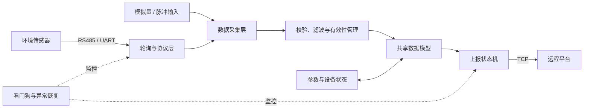
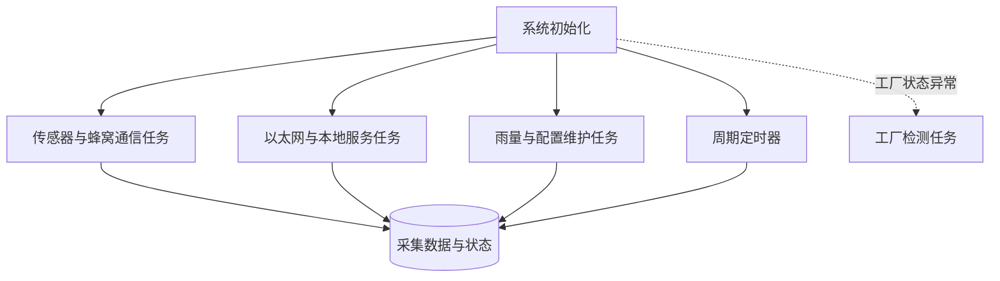
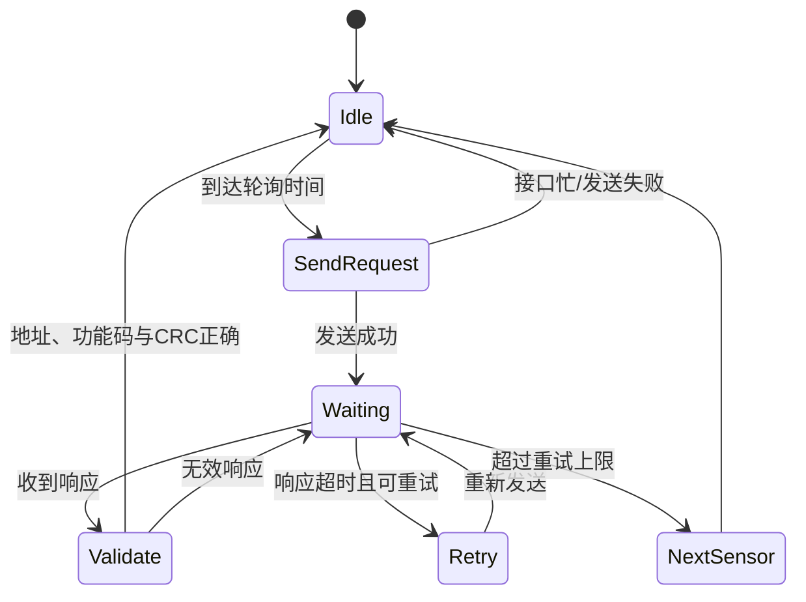
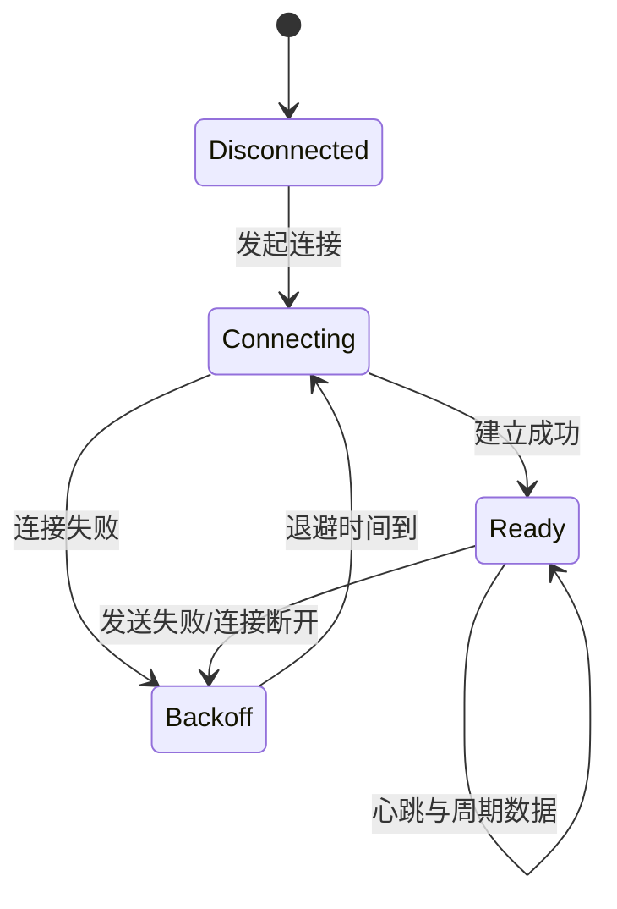

# STM32 工业环境数据采集器

> **Author: Hzhikai · 原创技术作品 · 开源交流学习 · MIT Licensed**

面向嵌入式软件岗位的项目展示仓库，来源于一套基于 STM32F103 的工业环境数据采集终端。原项目负责采集风速、风向、温湿度、气压、雨量等现场数据，通过 RS485 与传感器通信，并通过有线网络或蜂窝网络完成状态维护与远程上报。

本仓库中的公开代码、架构设计与技术文档由 **Hzhikai** 基于本人实际项目经验独立整理并授权发布，用于嵌入式技术交流、开源共同学习与求职作品展示。欢迎阅读、引用、讨论和改进，并请保留作者与许可证信息。

公开内容依据真实模块边界完成脱敏整理，重点展示通用算法、接口设计和状态机；不包含企业代码、真实设备参数、服务器地址、账号凭据、私有协议及厂商 SDK。

## 项目概览

| 项目维度 | 说明 |
| --- | --- |
| MCU 平台 | STM32F103 / ARM Cortex-M3 |
| 开发语言 | C |
| 实时系统 | 原项目最终版本采用 CMSIS-RTOS / Keil RTX 的多任务模型；公开代码保持 RTOS 无关 |
| 现场通信 | UART、RS485、Modbus RTU 风格传感器轮询 |
| 数据处理 | CRC16、有效性标记、移动平均、超时与重试 |
| 网络通信 | TCP 连接管理、心跳/周期上报、断线重连策略 |
| 工程工具 | Keil MDK（原项目）、CMake（公开代码的可选 Host 入口） |

## 原项目核心功能

- 多类环境传感器分时轮询，避免总线冲突并控制采集周期。
- RS485 半双工收发切换与 Modbus RTU 数据帧处理。
- 采集值有效性管理、异常值隔离与基础数字滤波。
- 多任务协作完成采集、设备维护、本地网络服务和远程上报。
- TCP 连接状态维护、超时检测、失败重试与主备链路恢复。
- 看门狗、供电异常检测、外设重初始化和运行状态持久化。
- 工厂检测、参数配置、外部 Flash 存储和固件升级支持。

这些内容描述原项目的整体工程职责；当前仓库只公开其中可安全抽象的通用部分。

## 系统架构



原固件按任务职责拆分如下。图中是逻辑关系，不代表本仓库包含完整 RTOS 工程。



## 公开代码模块

| 模块 | 路径 | 展示重点 |
| --- | --- | --- |
| Modbus RTU | `src/modbus_rtu.c` | CRC16、读保持寄存器请求、响应帧校验 |
| 数据滤波 | `src/moving_average.c` | 无动态内存的固定窗口移动平均 |
| 数据模型 | `src/acquisition.c` | 多传感器统一结构与字段有效性位图 |
| 轮询调度 | `src/sensor_scheduler.c` | 非阻塞轮询、超时、有限重试与设备切换 |
| 上报恢复 | `src/uplink_state.c` | TCP 连接阶段与有上限的指数退避 |
| 硬件抽象 | `include/daq/transport.h` | 通过函数指针解耦 UART/RS485 与业务逻辑 |
| 功能示例 | `examples/host_demo.c` | 串联采集、滤波和上报状态 |

### 传感器采集流程



### 网络异常恢复



## 目录结构

```text
.
├── include/daq/          # 公开接口与数据结构
├── src/                  # 通用协议、滤波和状态机实现
├── platform/             # 参考传输适配层
├── examples/             # 功能展示入口
├── docs/                 # 展示材料说明
├── CMakeLists.txt        # 可选 Host 构建入口
├── PUBLICATION_SCOPE.md  # 公开范围与版权边界
└── README_EN.md          # English overview
```

## 关键设计

### 1. 协议层与硬件解耦

`daq_transport_t` 仅定义读写回调。业务代码不直接访问 UART 寄存器，因此同一套轮询状态机可以连接 STM32 RS485 驱动或参考传输适配层。

### 2. 非阻塞轮询状态机

轮询模块不使用长时间忙等待。调用方传入系统时间，状态机根据轮询周期、响应期限和重试上限推进，适合放入 RTOS 周期任务中。

### 3. 显式的数据有效性

采集值与 `valid_mask` 同步维护。上报层能够区分“数值为零”和“本周期未获得有效数据”，避免把通信异常误报成真实测量值。

### 4. 有界资源使用

公开实现不使用动态内存。滤波窗口、协议帧和传输缓冲区均由调用方或静态结构持有，更符合资源受限 MCU 的运行方式。

## 关于构建

代码按 ISO C11 组织，并提供一个可选 CMake 入口。由于本仓库定位是求职展示，当前版本不包含 STM32 启动文件、链接脚本、Keil 工程、厂商库或硬件在环测试环境，也不声明可直接烧录到设备。

```bash
cmake -S . -B build
cmake --build build
./build/host_demo
```

以上命令仅作为具备 CMake 与 C 编译器时的 Host 构建入口；本次整理未在当前机器上执行编译验证。

## 公开范围与限制

- 仓库中的地址、寄存器映射和时间参数均已完成通用化与脱敏处理。
- 未包含真实服务器、域名、端口、设备身份、密钥或账号信息。
- 未包含原始固件、企业协议、Web 配置页面、OTA 包、历史 Git 记录或编译产物。
- 未包含 STM32 标准外设库、CMSIS、RTX/FreeRTOS、W5500 驱动及蜂窝模组 SDK。
- 原项目照片和运行截图尚未加入；补充要求见 [`docs/IMAGES_TODO.md`](docs/IMAGES_TODO.md)。

更详细的边界说明见 [`PUBLICATION_SCOPE.md`](PUBLICATION_SCOPE.md)。

## License

仓库内由 **Hzhikai** 创作并公开发布的代码与文档采用 [MIT License](LICENSE)。作者与授权说明见 [`AUTHORS.md`](AUTHORS.md)。该许可**不适用于**未收录的原始量产工程、企业代码、第三方 SDK、设备资料或私有协议。
